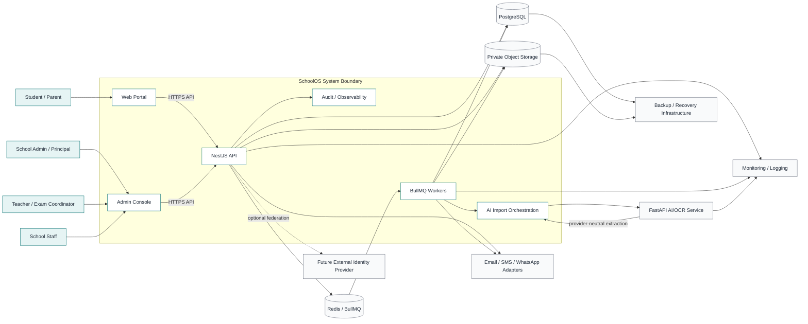

# D0.2 System Context Diagram

## Status

**Planning artifact.** D0.2 defines the external actors, runtime boundary, data stores, workers, and provider integrations around SchoolOS. It does not define internal module behavior; that belongs to later D0 artifacts.

## Context diagram



## Actors at context level

Detailed roles belong to D0.3, but the context boundary recognizes:

- school administrators and principals: configure and govern school operations
- teachers and exam coordinators: manage assigned academic work and review/import marks according to permission
- school staff: perform assigned operational tasks
- students and parents: consume permitted profiles, results, documents, notices, and future portal capabilities
- external providers: process only the contracted capability and never become authoritative over SchoolOS records

## Runtime responsibilities

| Component              | Responsibility                                                      | Authority boundary                                  |
| ---------------------- | ------------------------------------------------------------------- | --------------------------------------------------- |
| Web Portal             | Student/parent-facing views and actions                             | No direct data-store access                         |
| Admin Console          | Staff/admin workflows and review interfaces                         | No authorization decisions trusted from UI          |
| NestJS API             | Authentication, authorization, tenant scope, domain commands, reads | System entry point for clients                      |
| PostgreSQL             | Durable tenant-scoped business data                                 | Source of truth for official records                |
| Redis/BullMQ           | Queue messages, leases, ephemeral state, cache                      | Never source of truth for official marks            |
| BullMQ Workers         | Long-running processing, imports, reports, documents                | Must verify job scope and persist output before ack |
| AI Orchestration       | Staging, provider routing, extraction pipeline                      | AI output remains untrusted                         |
| FastAPI AI/OCR         | OCR/provider adapters and structured extraction                     | No direct marks/result database writes              |
| Private Object Storage | Original uploads, intermediate artifacts, generated files           | Files are private and authorization-controlled      |
| Audit/Observability    | Activity, provenance, metrics, logs, correlation                    | Must avoid unnecessary sensitive content            |
| Notification Adapters  | Delivery of approved events                                         | Delivery failure cannot mutate academic truth       |
| Backup/Recovery        | Encrypted backup and restore operations                             | Access restricted to operations role                |

## Trust boundaries

### Client to API

Clients are untrusted. The API authenticates the session, derives the tenant, validates input, checks permission, and applies business rules. Client-supplied school IDs, roles, permissions, and approval states are never authoritative.

### API to data stores

Only server-side modules access PostgreSQL, Redis, and private object storage. Every school-owned query carries tenant scope. Redis values and object keys are treated as untrusted references and checked against the owning job or school.

### Workers to API domain

Workers process authenticated, API-created jobs. They must verify job ownership, stage, version, and idempotency before writing. A worker cannot bypass the marks service or publish results directly.

### SchoolOS to AI/OCR provider

Only staged artifacts and minimum necessary context are sent. Provider calls are versioned and observable. Provider output is treated as untrusted extraction and retained with provenance. Privacy configuration must decide whether external providers are permitted for a school.

### SchoolOS to notification providers

Only approved notification events are sent. Provider delivery status is operational data, not proof that an academic action succeeded. Secrets and provider tokens remain in deployment secret management.

## Primary synchronous path

```text
User
  -> Web/Admin client
  -> NestJS API
  -> authenticate session
  -> derive school tenant
  -> authorize operation
  -> read/write PostgreSQL or private file metadata
  -> return bounded response
```

Use this path for normal CRUD, search, review reads, status reads, and short commands. Do not block it on OCR, large imports, PDF generation, exports, or long-running notifications.

## Primary asynchronous path

```text
API command
  -> durable job and artifact metadata
  -> Redis/BullMQ message
  -> worker claims task
  -> private storage / AI adapter / database service
  -> durable stage output
  -> progress and audit event
  -> next queue stage
  -> API status read or event to client
```

The API returns a job identifier quickly. Workers acknowledge only after durable state is written. Retries are idempotent and terminal failures are visible.

## Data ownership

- PostgreSQL owns users, tenants, students, enrollments, exams, marks, results, documents, notices, imports, and audit metadata.
- Object storage owns bytes for private uploads, source documents, intermediate artifacts, and generated files.
- Redis owns transient queue/workflow state and cache entries that can be rebuilt.
- The AI service owns provider execution and extraction response generation, not official academic data.
- Notification providers own delivery attempts according to their contracts, not SchoolOS domain state.

## Failure containment

- Frontend failure: no data mutation unless the API command was committed; idempotency protects retries.
- API failure before commit: transaction is not applied; client can retry safely where supported.
- Database failure: command fails visibly; official transaction rolls back.
- Queue failure: job remains durable and recoverable; no silent loss.
- Worker failure: task lease expires or retries; duplicate delivery is idempotent.
- AI provider failure: stage fails/retries or enters review; no official marks change.
- Storage failure: upload/generation fails safely; metadata does not claim a usable artifact.
- Notification failure: academic operation remains authoritative; delivery is retried/reported separately.
- Backup failure: operations alert and recovery policy escalates; backup success is verified, not assumed.

## D0.2 decisions

1. All user-facing business operations enter through the NestJS API.
2. PostgreSQL is the source of truth for official records.
3. Redis/BullMQ is for asynchronous work and transient coordination, not official data.
4. Object storage is private by default.
5. AI/OCR is an adapter behind an orchestration boundary and cannot write official marks/results.
6. Long-running work is asynchronous, durable, observable, retryable, and idempotent.
7. External notifications are event-driven adapters and are not part of core transaction success.
8. Tenant, permission, and audit checks apply at every API and worker boundary.

## Next artifact

**D0.3 — User and Actor Definition**, formalizing roles, responsibilities, scopes, permissions, and lifecycle for administrators, principals, teachers, coordinators, staff, students, parents, and operations users.
