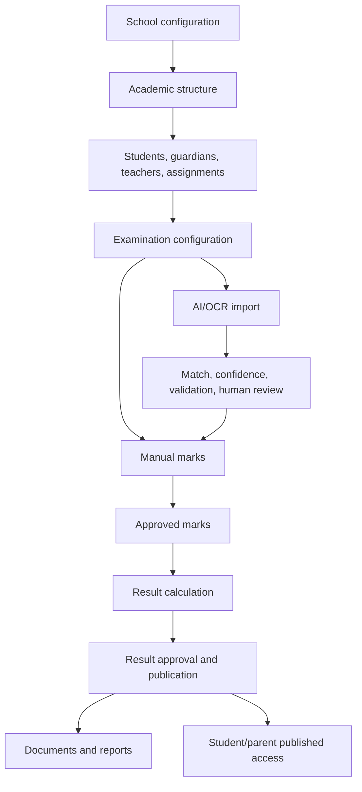
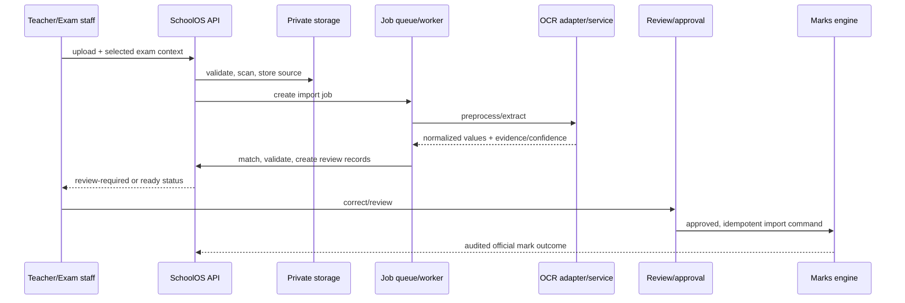
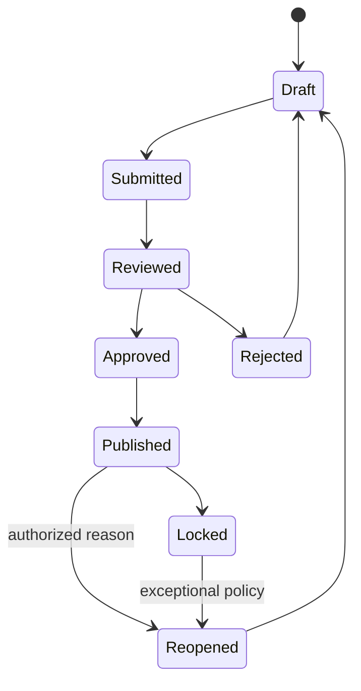
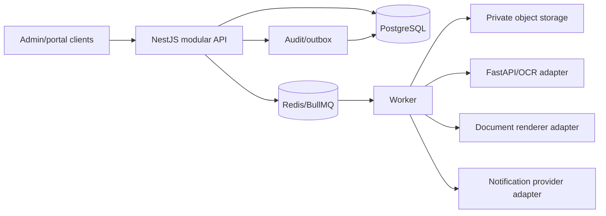

# Master Diagrams and Traceability

## Core end-to-end data flow

## Critical AI import sequence

## Marks and result state diagram

## Container/component diagram

## Permission matrix baseline

| Capability             | School admin    | Principal               | Exam coordinator      | Teacher                | Staff               | Student/parent       | Platform operator    |
| ---------------------- | --------------- | ----------------------- | --------------------- | ---------------------- | ------------------- | -------------------- | -------------------- |
| Tenant/settings/users  | manage          | view/approved actions   | delegated view        | —                      | limited             | —                    | tenant/platform only |
| Students/guardians     | manage          | view                    | assigned view         | assigned view          | delegated manage    | own/linked view      | emergency only       |
| Academic configuration | manage          | view                    | delegated manage      | assigned view          | limited             | —                    | emergency only       |
| Attendance             | manage/view     | view                    | view                  | assigned write         | delegated write     | own/linked read      | emergency only       |
| Exam/marks             | manage/override | approve policy          | manage/review/approve | assigned entry/submit  | limited             | published view       | emergency only       |
| AI import              | manage          | view/exception approval | manage/review/approve | assigned upload/review | —                   | —                    | service health only  |
| Results/documents      | manage          | approve/view            | calculate/generate    | assigned view          | delegated documents | published own/linked | emergency only       |
| Audit/platform         | school audit    | school audit            | assigned audit        | own actions            | own actions         | —                    | platform audit       |

## API resource contract map

| Domain             | Resource prefixes                                                                                             | High-risk controls                          |
| ------------------ | ------------------------------------------------------------------------------------------------------------- | ------------------------------------------- |
| Identity           | `/auth`, `/users`, `/roles`, `/permissions`                                                                   | sessions, scoped grants, access audit       |
| School/academic    | `/schools`, `/academic-years`, `/periods`, `/classes`, `/sections`, `/subjects`, `/offerings`, `/assignments` | tenant, configuration versions              |
| People/attendance  | `/students`, `/guardians`, `/teachers`, `/enrollments`, `/attendance`                                         | history, assignment/relationship scope      |
| Exam/marks/results | `/exams`, `/marks`, `/imports`, `/results`                                                                    | lifecycle, revision, idempotency, approvals |
| Documents/files    | `/templates`, `/documents`, `/files`, `/verification`                                                         | private objects, source/template versions   |
| Reports/comms      | `/reports`, `/exports`, `/notices`, `/notifications`                                                          | audience/filter scope, queued delivery      |
| Operations         | `/audit`, `/jobs`, `/platform`                                                                                | privileged support, redaction, time limits  |

## Traceability rules

Each `REQ-*` record in [Requirements Register](../requirements/requirements-register.md) maps to a D0.4 catalog row, a `BR-*` rule, entity set, endpoint group, screen, and automated/acceptance test. A change request cannot advance until all affected links are updated.
