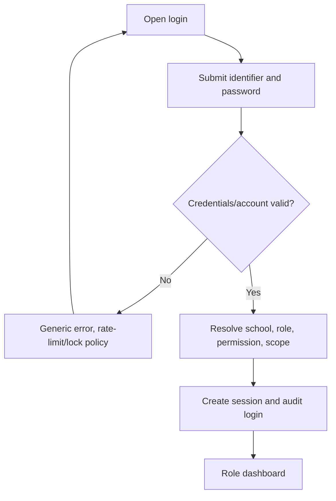
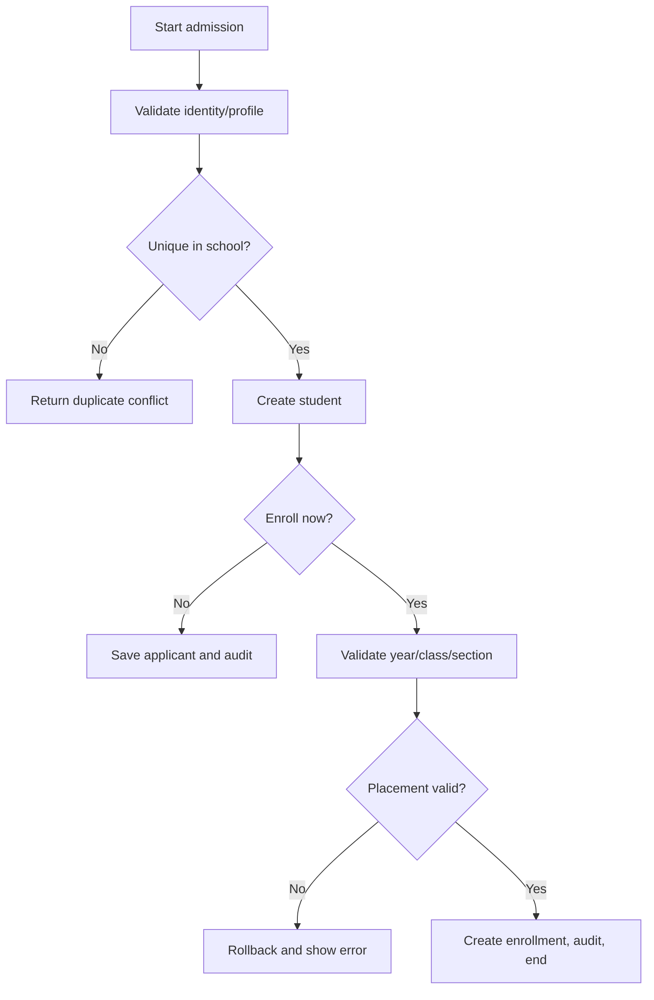
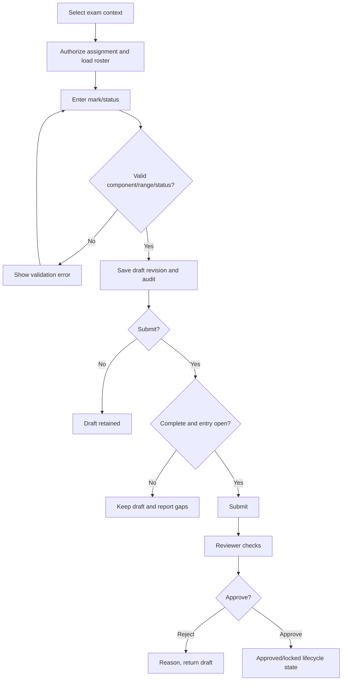
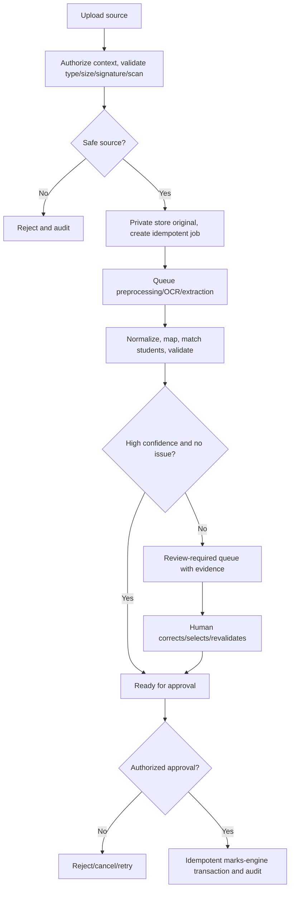
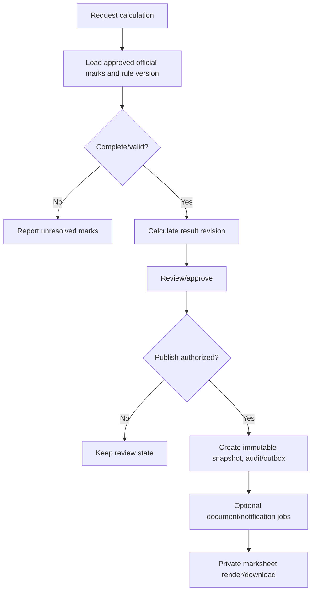

# Document 04 — Complete Activity Diagrams

## Shared activity controls

Every mutation includes authenticate → resolve tenant/scope → authorize → validate → transaction or durable job → audit/outbox → safe response. Exceptions do not expose cross-tenant data or silently discard evidence.

## Login and session

## Student admission and enrollment

## Manual marks, review, and approval

## AI/OCR import

## Results and documents

## Remaining required activity flows

| Workflow                    | Controlled flow                                                                    | Decisions/exceptions                                      |
| --------------------------- | ---------------------------------------------------------------------------------- | --------------------------------------------------------- |
| School setup                | create tenant → initial admin → profile/settings → audit                           | duplicate code, initial admin rollback, archive retention |
| Academic year setup         | draft year → validate dates → activate/version → close/archive                     | overlap/active-year policy, referenced history            |
| Teacher assignment          | select teacher/context → validate offering → create assignment/audit               | inactive/conflicting assignment                           |
| Subject configuration       | create/retire subject/type → offering → blueprint version                          | duplicate code, in-use version immutable                  |
| Exam creation               | draft exam → schedule/subjects/components → validate → open entry                  | invalid dates/configuration/eligibility                   |
| Bulk marks import           | map/preview → validate rows → confirmation → queued batch → item outcome           | duplicate/idempotency, row errors, job retry              |
| Student matching            | deterministic identifier → candidate scoring → exact/possible/ambiguous/no-match   | ambiguous/no-match requires review/manual mapping         |
| Marks validation            | component/status/range → completeness/lifecycle → accept/reject                    | absent/missing/exempt distinct; conflict/stale revision   |
| Result approval/publication | calculated → review → approve → snapshot → publish/lock                            | missing approvals; reopen requires reason/version         |
| Marksheet generation        | authorize result/template → queue render → checksum/store → private download       | missing template/render retry/revocation                  |
| Promotion                   | validate next placement → end prior enrollment → create next → audit               | duplicate active enrollment/invalid target                |
| Transfer                    | validate destination → end current enrollment → append transfer enrollment → audit | invalid destination/history/legal constraint              |
| Graduation                  | validate policy → complete enrollment → issue eligible documents → archive state   | incomplete academic requirement/authorized override       |
| Notice/notification         | draft → validate audience → approve/publish → queued delivery                      | provider retry/opt-out/expiry                             |
| File upload                 | authorize → validate/scan → quarantine/private store → attach/version              | unsafe source, storage error, retention hold              |
| Export/bulk documents       | validate scope → create job → process chunks → item results → expiry               | failed item/retry/dead-letter/authorization loss          |
| Maintenance/support         | approval/reason → time-bounded mode/access → operation/audit → expire              | emergency escalation/read-only fallback                   |

## Completion

These activity flows define inputs, decisions, alternative paths, exceptions, approvals, and ends. Detailed sequence interactions are the next document.
