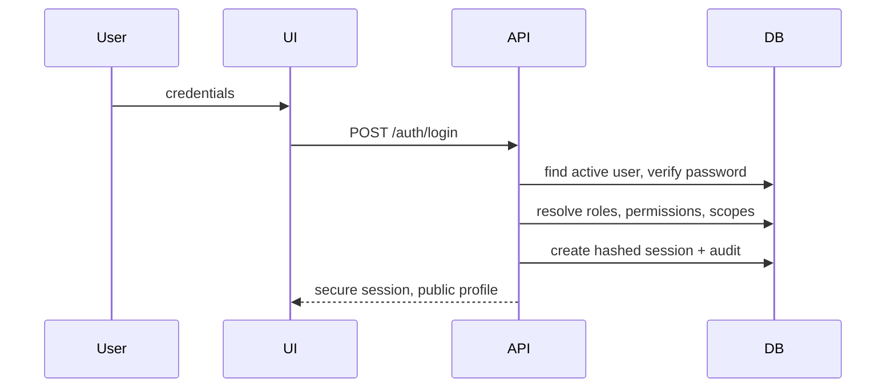
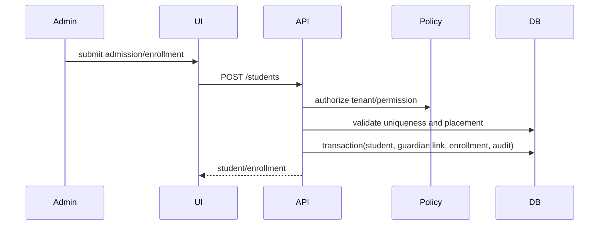
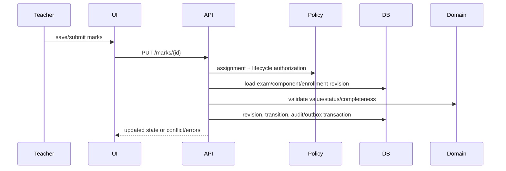
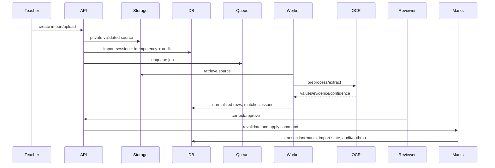
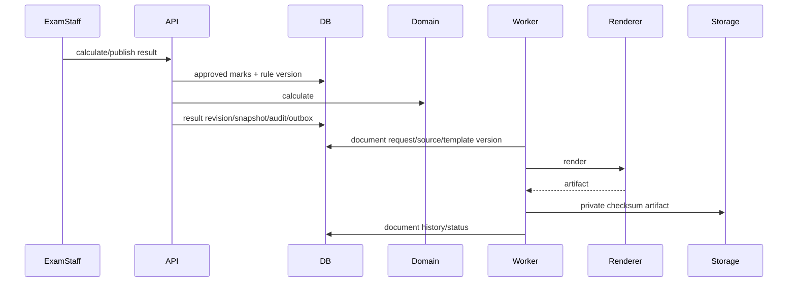

# Document 05 — Complete Sequence Diagrams

## Login

## Student admission

## Manual marks

## AI/OCR import

## Result and document

## Operational sequence rules

Every sequence begins with authentication, tenant/scope authorization, and correlation ID; authoritative writes are transactional; external calls use durable intents/jobs and retry/reconciliation; notification delivery never decides academic transaction success.
