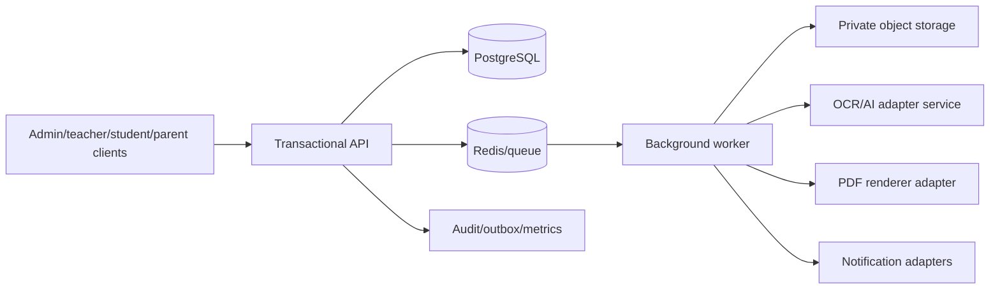

# Document 07 — System Architecture Specification

## Decision

Adopt a **modular monolith** for authoritative API/domain/data work, with separate worker and AI/OCR processes. This gives transactional integrity and manageable deployment while isolating expensive/untrusted processing. Microservices require evidence of scale/team/independent-release need.

## Boundaries

Modules: identity; school/configuration; academics; people/enrollment; attendance; exams; marks/results; imports; documents/templates; reports; notices/notifications; files; audit/operations. Controllers call application services; domain services enforce rules; repository/adapters own persistence/providers. Modules never directly mutate another module’s data; commands/events/outbox create explicit contracts.

## Data and asynchronous design

PostgreSQL is the source of truth; Redis is queue/cache/ephemeral state, not official history. Source/generated files are private object storage. Heavy jobs persist intent before enqueue, validate ownership/version/idempotency, report progress, retry safely, dead-letter/escalate, and reconcile. AI/OCR and renderer return proposals/artifacts only; the API controls official records.

## Deployment and observability constraints

Clients use TLS API access. API/worker/AI can scale independently. Environment configuration/secrets are separate per environment. Health, structured logs, metrics, traces, audit, queues, backups, and alerts are mandatory operational components.
